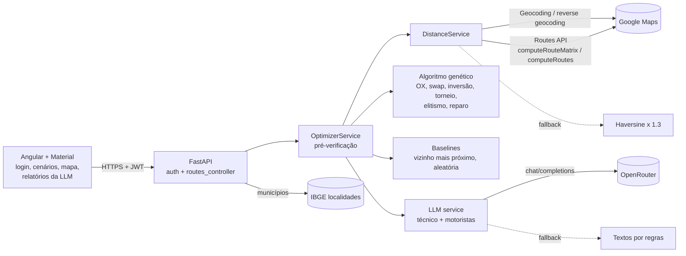
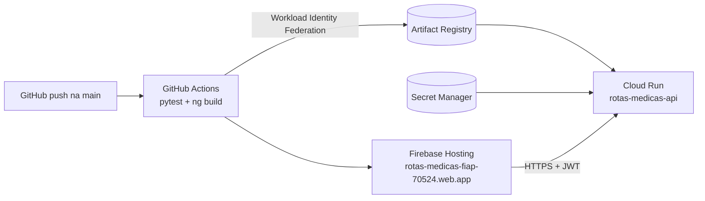

# Tech Challenge Fase 2: otimização de rotas para distribuição de medicamentos

Sistema que otimiza as rotas de distribuição de medicamentos e insumos hospitalares com um **algoritmo genético**. O problema é tratado como um VRP com frota heterogênea, prioridades, capacidade, autonomia com abastecimento, janelas de horário e regras sanitárias de transporte. As localizações e distâncias reais por estrada vêm do **Google Maps**, e uma **LLM via OpenRouter** gera dois textos por otimização: uma **análise técnica**, que compara as execuções anteriores e sugere ajustes de parâmetros, e as **instruções para os motoristas**. Cada público tem o seu chat de perguntas.

O algoritmo genético parte do código base [FIAP/genetic_algorithm_tsp](https://github.com/FIAP/genetic_algorithm_tsp). A aplicação está publicada no Google Cloud (link no fim deste documento) e o relatório técnico completo está em [`docs/`](docs/).

**Grupo 17 · Turma 11IADT**: Douglas de Souza Santos (RM376076), Elisangela de Souza Alves (RM376784) e Thiago Oliveira Teberga (RM376295).

## Situação atual

| Área | O que está pronto |
|---|---|
| Algoritmo genético | Representação com separadores, OX, swap, inversão (2-opt), torneio, elitismo, operador de reparo, semente (padrão 42) e parada por estagnação |
| Restrições | Capacidade, autonomia, prioridade e janelas configuráveis como soft ou hard; contaminação, refrigeração e autonomia do carro elétrico sempre rígidas; pré-verificação com resposta 422 explicando o motivo |
| Operação | Frota heterogênea (5 tipos), horários de chegada, esperas e atrasos, abastecimento na cidade e no caminho de trechos longos |
| Dados | Google Geocoding e Routes API, municípios do IBGE, fallback haversine sem chave |
| LLM | Análise técnica e instruções para motoristas em paralelo, histórico das execuções com as mesmas cidades, chats separados, retentativas e textos por regras quando a LLM não responde |
| Interface | Angular 20 + Angular Material, tema escuro, responsiva; login; cenário padrão, cidades aleatórias e cadastro manual; mapa com rotas e paradas de abastecimento |
| Segurança | Todas as rotas exigem token JWT, exceto o login; chaves em variáveis de ambiente e no Secret Manager |
| Nuvem | Cloud Run (backend) e Firebase Hosting (frontend), com CI/CD pelo GitHub Actions a cada push na `main` |
| Qualidade | 96 testes automatizados (pytest), rodando na CI antes de cada deploy |
| Documentação | Relatório técnico em Word e PDF com experimentos, resultados e um exemplo real avaliado da LLM |

## Arquitetura



Fluxo de uma otimização:
1. O frontend envia cidades (grupo, prioridade, demanda e janela), origem, destino, frota, horários, restrições, parâmetros do AG e os identificadores das execuções anteriores da sessão.
2. O backend monta a matriz NxN de distâncias e tempos (Routes API ou haversine) e verifica se as restrições rígidas são possíveis. Se não forem, responde 422 com os motivos.
3. O AG resolve o VRP; vizinho mais próximo e solução aleatória são calculados para comparação.
4. Para cada veículo, calcula horários, esperas, atrasos e abastecimentos e busca a geometria real da rota (polyline). Paradas para abastecer no meio de trechos longos são localizadas na geometria e nomeadas por geocodificação reversa.
5. O resultado em JSON (sem polylines) vai para a LLM em duas chamadas paralelas: análise técnica (`llm_technical`) e instruções para motoristas (`llm_driver`). Sem LLM, os dois textos são gerados por regras.
6. O resultado fica em memória com um identificador, usado nas perguntas em linguagem natural e no histórico.

## Algoritmo genético

| Item | Implementação |
|---|---|
| Representação | Permutação dos pontos de entrega + `K-1` separadores negativos (`-1, -2, …`) que dividem a sequência entre os `K` veículos; a i-ésima rota é feita pelo i-ésimo veículo da frota |
| População inicial | Aleatória (já reparada) + 1 indivíduo do vizinho mais próximo (TODO do código base) |
| Seleção | Torneio (k configurável) + elitismo |
| Crossover | Order Crossover (OX), o mesmo do código base |
| Mutação | Troca de dois genes ou inversão de segmento (2-opt, TODO do código base) |
| Reparo | Entregas que quebram contaminação/refrigeração são movidas para o veículo compatível mais barato (respeitando capacidade e autonomia quando possível) |
| Critério de parada | Limite de gerações ou estagnação: para se o melhor fitness não melhorar por `stagnation_generations` gerações (padrão 100; 0 desativa) |
| Reprodutibilidade | `seed` (padrão 42; `null` = aleatória): mesma semente e parâmetros, mesmo resultado |
| Fitness (minimizar) | `distância total + w·Σ(km acumulado até cada entrega crítica) + soft_penalty·(violações soft) + 1.000.000·(violações hard)` |

### Medicamentos/insumos e regras de transporte

Cada cidade recebe um grupo (`product_group`): fixo no cenário padrão, sorteado no modo aleatório (editável na tela) e escolhido no cadastro manual.

| Grupo | Regra |
|---|---|
| Medicamentos/Insumos A | Não pode ser transportado junto com C (risco de contaminação) |
| Medicamentos/Insumos B | Deve ser transportado **sozinho**, em **caminhão com refrigeração** |
| Medicamentos/Insumos C | Não pode ser transportado junto com A |
| Medicamentos/Insumos D e E | Sem restrição |

Contaminação e refrigeração são **sempre rígidas**. O cadastro fica em `backend/app/data/catalog.py` e é exposto em `GET /api/catalog`.

### Frota heterogênea

| Tipo | Autonomia | Peso máximo | Observação |
|---|---|---|---|
| Moto | 140 km | 15 kg | |
| Carro | 500 km | 250 kg | |
| Carro elétrico | 300 km | 300 kg | Não recarrega na rota; autonomia **sempre** rígida |
| Caminhão com refrigeração | 600 km | 1000 kg | Único apto a levar o grupo B |
| Caminhão sem refrigeração | 700 km | 1000 kg | |

A frota padrão tem um veículo de cada tipo (até 10 veículos). Na tela, ao mudar a quantidade de veículos é sorteada uma frota com tipos aleatórios; o tipo de cada veículo pode ser trocado na grade, e cada um tem um botão de exclusão.

### Janelas de horário

Cada cidade tem uma janela de recebimento (`window_start`–`window_end`). Os veículos saem da origem no `departure_time` (padrão 07:00) e ficam `service_minutes` (padrão 15) em cada entrega. Chegar antes da janela gera espera; chegar depois gera atraso. A resposta traz a chegada prevista em cada parada.

### Abastecimento em rota

Todos os veículos saem de **tanque cheio**. Antes de cada trecho, se o percurso deixaria a autonomia abaixo da **reserva** (padrão 15%), o veículo **abastece na cidade em que está** (padrão 15 min). Se o próprio trecho for maior que a autonomia útil (ex.: 500 km de autonomia num trecho de 4.000 km), o veículo **abastece no caminho quantas vezes for preciso**, sempre ao atingir a reserva, e nunca chega com 0%. O ponto de cada parada é estimado sobre o traçado real da rota e nomeado por geocodificação reversa (ex.: "Uberlândia, MG"); sem Google, aparece como "km X do trecho A → B". Cada parada soma o tempo de abastecimento aos horários seguintes. O **carro elétrico nunca abastece**: sua autonomia vale para o percurso inteiro.

Parâmetros em `schedule`: `refuel_enabled` (padrão `true`), `refuel_reserve_pct` e `refuel_minutes`. A resposta traz, por veículo, `refuels` (local, `en_route`, trecho, km no trecho, lat/lng, horário e autonomia restante); o painel lista as paradas, o mapa mostra marcadores ⛽ e a LLM as inclui nas instruções dos motoristas.

### Restrições configuráveis

Cada restrição pode ser **rígida (hard)** ou **flexível (soft)**, pelo campo `constraints` da requisição ou pela tela:

| Restrição | Soft (flexível) | Hard (rígida) | Padrão |
|---|---|---|---|
| Capacidade | Excesso permitido, custo `soft_penalty` por kg | Nunca excede | hard |
| Autonomia | Excesso permitido, custo `soft_penalty` por km (contando a volta); exceto carro elétrico | Nunca excede | hard |
| Prioridade | Críticas tendem a vir antes, pelo peso `priority_weight` | Em cada veículo, todas as críticas antes de qualquer regular | soft |
| Janela de horário | Atraso permitido, custo `soft_penalty` por minuto | Nunca chega depois do fim da janela | soft |
| Contaminação e refrigeração | — | Sempre rígida | hard |

- `soft_penalty` (padrão 50) é o custo, em km equivalentes, de cada kg, km ou minuto excedido. Valores baixos aceitam excessos para encurtar a rota; valores altos aproximam a restrição de uma rígida.
- Uma violação **hard** custa 1.000.000 por unidade, então qualquer solução que respeite as restrições rígidas vence as que não respeitam.
- Antes de rodar o AG, o backend verifica se as restrições rígidas são possíveis: carga refrigerada sem caminhão refrigerado, frota com menos veículos do que a separação dos grupos exige, demanda maior que o veículo apto ou que a frota, cidade fora do alcance da autonomia, chegada impossível dentro da janela. Se não forem, ou se o AG não achar solução válida, a API responde **422** com a mensagem e os motivos.
- A resposta indica, por veículo, `capacity_ok`, `autonomy_ok`, `priority_ok`, `contamination_ok` e `time_ok`, os grupos transportados e o horário de cada parada; além de `feasible` (nenhuma restrição rígida violada) e `soft_violations` (excessos aceitos nas flexíveis).
- **Origem e destino diferentes:** a rota é aberta (origem → entregas → destino). Com origem igual ao destino, é ida e volta.

## LLM

| Texto | Público | Conteúdo |
|---|---|---|
| Análise técnica | Equipe que testa e calibra o sistema | Diagnóstico, comparação com execuções anteriores, qualidade da solução, convergência, restrições e frota, sugestões de parâmetros (valor atual, sugerido e por quê) e próximos testes |
| Instruções para motoristas | Motoristas e equipes de entrega | O que carregar, paradas com horário e janela, abastecimentos, cuidados com os grupos e a cadeia de frio |

- **Contexto:** parâmetros executados, frota inteira (inclusive veículos não usados), cidades, rotas com horários e abastecimentos, resumo da convergência e comparativo com as outras abordagens.
- **Histórico na análise técnica:** o frontend envia `previous_result_ids` com as execuções anteriores da sessão. As que têm as mesmas cidades, origem e destino (até 5) entram no contexto da análise técnica e do chat técnico: parâmetros, resultados, o que mudou de uma execução para a outra e as sugestões já feitas. Assim a LLM compara as execuções e não sugere valores já testados. Mudou alguma cidade, a origem ou o destino, o histórico recomeça. O histórico fica em memória e se perde quando o Cloud Run desliga a instância.
- **Robustez:** retentativas em 429/502/503 (respeitando `Retry-After`), modelos reserva (`OPENROUTER_FALLBACK_MODELS`), nova tentativa com mais tokens quando a resposta vem vazia ou cortada, e esforço de raciocínio baixo.
- **Sem LLM:** os dois textos são gerados por regras, inclusive a comparação com as execuções anteriores e sugestões que não repetem valores já testados.

## Modos de cenário

- **Cenário padrão:** 5 cidades fixas de SP, com São Paulo como origem e destino.
- **Cidades aleatórias:** sorteia N cidades (3 a 52) do catálogo de SP, com grupo, prioridade, demanda e janela aleatórios (editáveis).
- **Cadastro manual:** cidade a cidade, de qualquer estado. Para cada uma informe estado, cidade (com sugestões do IBGE), papel (origem, destino, origem e destino ou entrega) e, nas entregas, grupo, prioridade, demanda e janela. O nome é conferido na lista oficial de municípios do IBGE (com sugestão em caso de erro de digitação) e as coordenadas vêm do Google Maps. Só há uma origem e um destino: escolher o papel em uma cidade tira esse papel das outras. A lista fica salva no navegador.

## Como executar localmente

### Backend (Python 3.13)

```bash
cd backend
python -m venv .venv
.venv\Scripts\activate          # Linux/macOS: source .venv/bin/activate
pip install -r requirements-dev.txt   # requirements.txt = só produção
copy .env.example .env          # Linux/macOS: cp .env.example .env
uvicorn app.main:app --reload --port 8000
```

A documentação da API (Swagger) fica em http://localhost:8000/docs.

Variáveis de ambiente (`backend/.env`, nunca versionado):

| Variável | Uso |
|---|---|
| `GOOGLE_MAPS_API_KEY` | Habilite **Geocoding API** e **Routes API** no Google Cloud. Sem chave, as distâncias são estimadas por haversine. |
| `OPENROUTER_API_KEY` | Chave do https://openrouter.ai. Sem chave, os textos são gerados por regras. |
| `OPENROUTER_MODEL` | Modelo do OpenRouter (padrão `anthropic/claude-haiku-5.5`). |
| `OPENROUTER_FALLBACK_MODELS` | Modelos reserva, separados por vírgula. |
| `CORS_ORIGINS` | Origens do frontend (padrão `http://localhost:4200`). |
| `AUTH_USERNAME` / `AUTH_PASSWORD` | Usuário de acesso. Defina os seus valores; não use os do exemplo fora do ambiente local. |
| `JWT_SECRET` | Segredo para assinar os tokens. Se ficar vazio, é gerado um novo a cada start e os logins expiram ao reiniciar. |
| `JWT_EXPIRE_MINUTES` | Validade do token (padrão 480 = 8 h). |

Testes e experimentos:

```bash
pytest
python -m scripts.experiments --cities 20 --vehicles 3 --runs 3
```

### Frontend (Node 22)

```bash
cd frontend
npm install
npm start          # http://localhost:4200
```

A URL da API fica em `frontend/src/environments/environment.ts` (no deploy, o pipeline usa a URL do Cloud Run).

## Autenticação

Todas as rotas da API exigem um token JWT no cabeçalho `Authorization: Bearer <token>`. A única exceção é o login. O usuário é fixo e configurado no backend por variáveis de ambiente; na nuvem, a senha e o segredo do JWT ficam no Secret Manager.

1. `POST /api/auth/login` com `{"username": "...", "password": "..."}` devolve `access_token`.
2. Envie o token nas demais chamadas. Sem token, ou com token inválido ou expirado, a API responde `401`.
3. No Swagger (`/docs`), use o botão **Authorize** e cole o token.

O frontend abre na tela de login, guarda o token no `sessionStorage` e volta para o login quando a sessão expira ou a API responde 401.

## Deploy no Google Cloud (CI/CD)



| Componente | Serviço |
|---|---|
| Backend (FastAPI) | Cloud Run `rotas-medicas-api` em `southamerica-east1`, escala a zero, no máximo 1 instância, timeout de 300 s |
| Frontend (Angular) | Firebase Hosting (projeto Firebase `rotas-medicas-fiap-70524`) |
| Imagens | Artifact Registry `rotas-medicas` (mantém as 5 mais recentes) |
| Segredos | Secret Manager: `google-maps-api-key`, `openrouter-api-key`, `auth-password`, `jwt-secret` |
| Autenticação do CI | Workload Identity Federation, sem chave JSON; só a branch `main` deste repositório faz deploy |
| Custos | Alerta de orçamento de R$ 50 |

Pipelines (`.github/workflows/`):
- **ci.yml**: em PRs e nas demais branches, roda `pytest` e o build de produção do Angular.
- **deploy.yml**: em push na `main`, roda os testes, publica a imagem no Artifact Registry e o backend no Cloud Run, confere que `/api/health` sem token responde 401 e publica o frontend no Firebase Hosting.

A infraestrutura é criada uma única vez com `bash infra/setup-gcp.sh` (lê os segredos do `backend/.env` sem exibi-los). Para trocar um segredo:

```bash
printf '%s' "novo-valor" | gcloud secrets versions add auth-password --data-file=-
```

O valor novo passa a valer no próximo deploy.

## Endpoints

| Método | Rota | Descrição |
|---|---|---|
| POST | `/api/auth/login` | Login; devolve o token de acesso (rota pública) |
| GET | `/api/auth/me` | Usuário dono do token |
| GET | `/api/health` | Status e provedores ativos |
| GET | `/api/catalog` | Grupos de medicamentos/insumos, regras de transporte e tipos de veículo |
| GET | `/api/cities/default` | As 5 cidades fixas (São Paulo é o hub) |
| GET | `/api/cities/random?count=N` | Sorteia N cidades reais com grupo, prioridade, demanda e janela aleatórios |
| GET | `/api/geo/states` | Estados brasileiros (cadastro manual) |
| GET | `/api/geo/states/{uf}/cities` | Municípios do estado, via API de localidades do IBGE |
| POST | `/api/cities/geocode` | Coordenadas de um município (`city`, `state`): nome conferido no IBGE e coordenadas do Google Maps |
| POST | `/api/routes/optimize/default` | Otimiza o cenário padrão (origem e destino em São Paulo) |
| POST | `/api/routes/optimize` | Otimiza cidades informadas com `origin_index` e `destination_index` |
| POST | `/api/routes/ask` | Pergunta em linguagem natural sobre um resultado (`result_id`); `audience`: `technical` (execução e parâmetros) ou `driver` (trajeto) |

Exemplo de corpo de `/api/routes/optimize`:

```json
{
  "locations": [{"name": "Campinas, SP", "lat": -22.9, "lng": -47.06, "priority": "critical", "demand": 30,
                 "product_group": "A", "window_start": "08:00", "window_end": "12:00"}, "..."],
  "origin_index": 0,
  "destination_index": 3,
  "vehicles": [{"type": "caminhao_refrigerado"}, {"type": "carro"}, {"type": "carro_eletrico"}],
  "schedule": {"departure_time": "07:00", "service_minutes": 15, "refuel_enabled": true, "refuel_reserve_pct": 15, "refuel_minutes": 15},
  "ga": {"population_size": 100, "generations": 300, "mutation_probability": 0.3, "tournament_size": 3, "elite_size": 2, "priority_weight": 0.5,
         "seed": 42, "stagnation_generations": 100},
  "constraints": {"capacity": "hard", "autonomy": "hard", "priority": "soft", "time_window": "soft", "soft_penalty": 50},
  "use_llm": true,
  "previous_result_ids": []
}
```

## Estrutura

```
.github/workflows/               # ci.yml (testes + build) e deploy.yml (GCP)
backend/
  app/
    api/auth.py                  # login e validação do JWT
    api/routes_controller.py     # controller REST
    services/
      vrp.py                     # representação, fitness, horários e abastecimento
      genetic_algorithm.py       # operadores, reparo e loop do AG
      heuristics.py              # vizinho mais próximo / aleatória
      google_maps.py             # Geocoding, reverse geocoding e Routes API
      distance.py                # provedor de distância com fallback
      llm.py                     # OpenRouter, prompts, histórico e textos por regras
      optimizer_service.py       # pré-verificação e orquestração
    data/catalog.py              # grupos de medicamentos/insumos e tipos de veículo
    data/cities.py               # cenário padrão + pool para sorteio
    data/geo.py                  # estados e municípios (IBGE)
    schemas.py / config.py       # DTOs (Pydantic) e configuração
  scripts/experiments.py         # comparação de configurações do AG
  tests/                         # 96 testes (pytest)
  Dockerfile
frontend/                        # Angular 20 + Angular Material + Leaflet (Firebase Hosting)
infra/setup-gcp.sh               # criação única da infraestrutura no GCP
docs/                            # relatório técnico (Word e PDF) e figuras
```

## Acesso

Aplicação publicada: https://rotas-medicas-fiap-70524.web.app/
